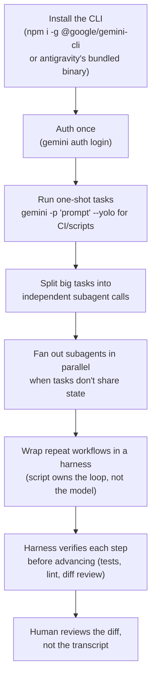

Antigravity ships a browser-based agent manager, but the same agent runs headless from a terminal. Once it's a CLI, it composes with everything else you script: cron, CI, git hooks, other CLIs. The next lever past "one agent, one task" is splitting work across subagents, and the lever past that is a harness, a script that drives the agent loop deterministically instead of trusting one long free-form session.

## Flow

## Steps

1. **Install and auth once.** `npm install -g @google/gemini-cli` (or the Antigravity-bundled binary), then `gemini auth login`. Same OAuth identity as the Antigravity IDE/browser agent, no separate API key management for personal use.
2. **Use one-shot mode for anything scriptable.** `gemini -p "<prompt>"` runs non-interactively and exits; add `--yolo` (or the CLI's equivalent auto-approve flag) to skip confirmation prompts in CI, cron, or git hooks. Never `--yolo` against a shared/production environment without a human-reviewed diff downstream.
3. **Split before you scale.** A single agent session degrades on long, multi-part tasks, context drifts, earlier instructions get deprioritized. Break the task into independent units (one file, one endpoint, one test suite) *before* reaching for more agent calls.
4. **Fan out subagents only when units are truly independent.** If task B needs task A's output, that's a pipeline, not parallel subagents, run them sequentially. If five files need the same mechanical edit with zero shared state, that's parallel.
5. **Promote a repeated multi-step workflow into a harness.** The moment you're running the same "prompt → check → prompt → check" sequence by hand more than twice, script it. The harness (a plain script, not another agent) owns the loop, retries, and pass/fail gates; the agent just fills in the reasoning-heavy step it's called for.
6. **Put a real check after every non-trivial step**, not a vibe check on the transcript: run the test suite, run the linter, diff against `main`, assert on structured output. An agent step with no verification step is a step you're trusting blind.
7. **Review the diff, not the narration.** A subagent's summary describes intent, not necessarily what happened. Read what actually changed before treating a step as done.

## Tips

- One-shot CLI calls compose with anything that can shell out: a git pre-commit hook, a Makefile target, a scheduled job. Treat the agent as a Unix-style filter, not a chat window.
- Give each subagent a self-contained prompt: file paths, the exact function/symbol, what "done" looks like. It has no memory of your conversation, a vague "fix the bug" produces a vague fix.
- Independent ≠ unrelated. Five call sites of the same renamed function are independent edits (no shared state) even though they're part of one refactor, safe to parallelize.
- A harness is not a bigger prompt. If you're tempted to cram "do X, then verify Y, then if Y fails do Z" into one mega-prompt, that branching belongs in the script, not the model.
- Keep harness scripts boring: a loop, a subprocess call, an exit-code check. The interesting part is the agent call inside it, not the scaffolding around it.

## Common pitfalls

- **Treating the browser agent manager and the CLI as different tools**: they're the same underlying agent; the CLI just drops the UI, which is exactly what you want for automation.
- **`--yolo` in a shared environment**: auto-approve is for disposable branches/sandboxes, not anything touching main or production config.
- **Parallelizing tasks with hidden shared state** (same file, same lock, same external resource), looks independent, isn't; you get merge conflicts or race conditions instead of speedup.
- **One subagent doing five unrelated things**: defeats the purpose; if the prompt needs "and also," split it.
- **No verification step**: an agent claiming success and an agent actually succeeding are different events; only a run test/lint/diff distinguishes them.
- **Reaching for a harness on a one-off task**: if you'll run it once, just run the CLI directly; scripting the loop only pays off once you're repeating it.

## Related

- [Automation and Dev Tooling](/notes/automation-and-dev-tooling/)
- [Linux Terminal and Shell Scripting](/notes/linux-terminal-and-shell-scripting/)
- Mentorship Hub chat
