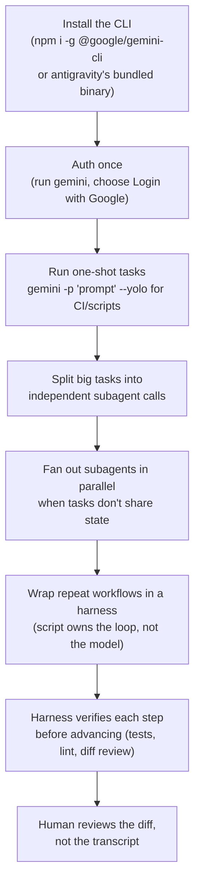

Antigravity ships a browser-based agent manager, but the same agent runs headless from a terminal. Once it is a CLI, you can script it with cron, CI, git hooks, and other CLIs. The next step past "one agent, one task" is splitting work across subagents. The step after that is a harness: a script that drives the agent loop in a fixed order, instead of trusting one long free-form session.

## Flow

## Steps

1. **Install and auth once.** Run `npm install -g @google/gemini-cli` (or use the Antigravity-bundled binary). Then run `gemini` and choose Login with Google in the prompt. It uses the same OAuth identity as the Antigravity IDE and browser agent. Personal use needs no separate API key.
2. **Use one-shot mode for anything scriptable.** `gemini -p "<prompt>"` runs non-interactively and exits. Add `--yolo` (or the CLI's equivalent auto-approve flag) to skip confirmation prompts in CI, cron, or git hooks. Do not use `--yolo` against a shared or production environment unless a person reviews the diff afterward.
3. **Split before you scale.** One agent session gets worse on long, multi-part tasks. Context drifts, and earlier instructions lose weight. Split the task into independent units (one file, one endpoint, one test suite) before you make more agent calls.
4. **Fan out subagents only when units are truly independent.** If task B needs task A's output, run them in order. That is a pipeline, not parallel work. If five files need the same mechanical edit and share no state, run them in parallel.
5. **Turn a repeated multi-step workflow into a harness.** Once you run the same "prompt, check, prompt, check" sequence by hand more than twice, script it. The harness (a plain script, not another agent) owns the loop, the retries, and the pass/fail checks. The agent fills in the reasoning-heavy step it is called for.
6. **Run a real check after every non-trivial step.** Do not rely on a read of the transcript. Run the test suite, run the linter, diff against `main`, or assert on structured output. An agent step with no check is a step you trust blind.
7. **Review the diff, not the narration.** A subagent's summary states what it meant to do, not always what it did. Read the actual changes before you mark a step done.

## Tips

- One-shot CLI calls work with anything that can shell out: a git pre-commit hook, a Makefile target, a scheduled job. Treat the agent as a Unix-style filter, not a chat window.
- Give each subagent a self-contained prompt with file paths, the exact function or symbol, and what done looks like. It has no memory of your conversation. A vague "fix the bug" gets a vague fix.
- Independent does not mean unrelated. Five call sites of one renamed function are independent edits with no shared state, even though they belong to one refactor. They are safe to parallelize.
- A harness is not a bigger prompt. If you are tempted to put "do X, verify Y, and if Y fails do Z" in one prompt, put that branching in the script, not the model.
- Keep harness scripts simple: a loop, a subprocess call, an exit-code check. The agent call is the part that matters. The scaffolding is not.

## Common pitfalls

- **Treating the browser agent manager and the CLI as different tools**: they run the same agent. The CLI drops the UI, which is what you want for automation.
- **`--yolo` in a shared environment**: use auto-approve only on disposable branches or sandboxes. Never use it on anything that touches main or production config.
- **Parallelizing tasks with hidden shared state** (same file, same lock, same external resource): these look independent but are not. You get merge conflicts or race conditions instead of a speedup.
- **One subagent doing five unrelated things**: this defeats the purpose. If the prompt says "and also," split it.
- **No verification step**: an agent that says it succeeded and an agent that did succeed are different things. Only a test, a lint run, or a diff tells them apart.
- **Building a harness for a one-off task**: if you run it once, run the CLI directly. A script for the loop pays off only when you repeat it.

## Related

- [Automation and Dev Tooling](/notes/automation-and-dev-tooling/)
- [Linux Terminal and Shell Scripting](/notes/linux-terminal-and-shell-scripting/)
