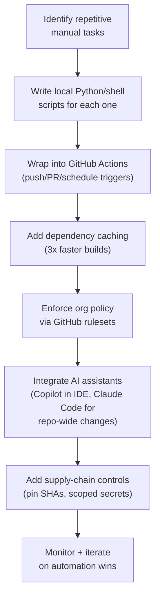

Three layers work together to remove manual toil: local scripts for immediate automation, CI pipelines for consistent enforcement, and AI coding assistants amplifying both.

## Flow

## Steps

1. **Identify repetitive manual tasks** by auditing a week: running tests locally, checking for committed secrets, validating Terraform plans, scanning dependencies, deploying to staging by hand.
2. **Write local scripts per concern**, not one mega-script: a secrets-detection script, a scanner-output normalizer, a Kubernetes YAML validator, a Terraform-JSON policy checker. Easier to reason about and reuse.
3. **Wrap them into CI workflows** triggered on push, PR, schedule (cron), or manual dispatch. Use matrix strategies to run across OS/language versions in parallel for free.
4. **Cache dependencies aggressively** (pip/npm/gem), this alone often cuts build time by ~3x; key the cache off the lockfile.
5. **Enforce policy centrally via GitHub rulesets** (who can trigger workflows, which event types are allowed) instead of scattering security logic per-workflow.
6. **Integrate AI assistants deliberately, not interchangeably.** GitHub Copilot for IDE-level completion and PR review; Claude Code as a terminal agent for repository-wide refactors, IaC changes, and multi-file debugging.
7. **Add supply-chain controls:** pin GitHub Actions to full commit SHAs (never a mutable branch/tag), lock dependencies so a workflow runs exactly what was reviewed, and scope secrets to specific branches/environments.
8. **Monitor CI observability and egress traffic**: stream Actions telemetry somewhere durable, and run any egress firewall in observation mode for a few weeks before enforcing.
9. **Measure and iterate quarterly**: track time saved and bugs caught, and expand what's working into new areas.

## Tips

- Pin every GitHub Action to a full SHA (`actions/checkout@<sha>`), never a branch or mutable tag.
- Matrix builds catch environment-specific bugs with almost no extra pipeline code.
- Treat "DevSecOps as code": scanners emit raw JSON → a script normalizes it to Markdown with a clear pass/fail → CI enforces the policy → exceptions route to a human for judgment calls only.
- Use Copilot and Claude Code for different jobs rather than swapping between them randomly: Copilot for fast, local completions; Claude Code when the change spans the repo.
- It's normal to run more than one CI system at once (GitHub Actions for new services, Jenkins for legacy), don't force a forced consolidation just for tidiness.

## Common pitfalls

- **Unnormalized scanner output** causes alert fatigue, always convert raw tool output into a structured report with a clear pass/fail before it reaches a human.
- **Automating security checks with no threat model**: creates false positives developers learn to ignore.
- **Missing `concurrency` groups + `cancel-in-progress: true`**: PRs accumulate runaway job counts and burn through CI minutes.
- **Secrets hardcoded in YAML** or relying on implicit credential inheritance, use scoped secrets / OIDC instead.
- **Treating Copilot and Claude Code as interchangeable**: they're optimized for different scopes (IDE speed vs. project-scale reasoning).
- **Skipping dependency locking**: a malicious transitive-dependency update can propagate through your whole pipeline unnoticed.
- **Jumping straight to egress firewall enforcement** without an observation period first, you need real telemetry to build an accurate allowlist before blocking traffic.

## Related

- [Linux Terminal and Shell Scripting](/notes/linux-terminal-and-shell-scripting/)
- [Integrations for Process Efficiency](/notes/integrations-for-process-efficiency/)
- Mentorship Hub chat

## Sources

- [GitHub Actions 2026 Security Roadmap](https://github.blog/news-insights/product-news/whats-coming-to-our-github-actions-2026-security-roadmap/)
- [Best CI/CD Tools for 2026: What the Data Actually Shows](https://blog.jetbrains.com/teamcity/2026/03/best-ci-tools/)
- [GitHub Copilot vs Claude Code: Which AI Coding Assistant Should You Use in 2026?](https://iampankajaswal.medium.com/github-copilot-vs-claude-code-which-ai-coding-assistant-should-you-use-in-2026-c868c6950539)
- [7 Python DevSecOps Automation Scripts That Save Time](https://www.fyld.pt/blog/7-python-devsecops-automation-scripts/)
- [GitHub Actions in 2026: Automate Everything for Free (CI/CD Tutorial)](https://dev.to/ottoaria/github-actions-in-2026-automate-everything-for-free-cicd-tutorial-4aj1)
