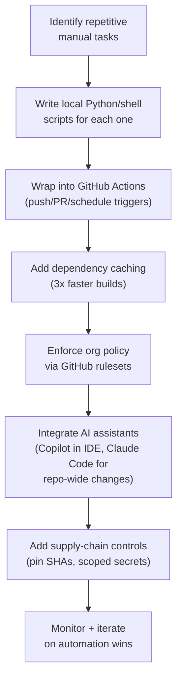

Three layers remove manual work: local scripts for quick automation, CI pipelines for consistent checks, and AI coding assistants that speed up both.

## Flow

## Steps

1. **Identify repetitive manual tasks.** Audit one week of work. Look for tasks like running tests locally, checking for committed secrets, validating Terraform plans, scanning dependencies, and deploying to staging by hand.
2. **Write one script per concern**, not one large script: a secrets-detection script, a scanner-output normalizer, a Kubernetes YAML validator, a Terraform-JSON policy checker. Small scripts are easier to understand and reuse.
3. **Wrap them in CI workflows** that run on push, PR, schedule (cron), or manual dispatch. Matrix strategies run jobs across OS and language versions in parallel at no extra cost.
4. **Cache dependencies** (pip/npm/gem). Caching alone often cuts build time by about 3x. Key the cache on the lockfile.
5. **Set policy in GitHub rulesets** (who can trigger workflows, which event types are allowed). Do not spread security logic across each workflow.
6. **Pick each AI assistant for a specific job.** Use GitHub Copilot for IDE completion and PR review. Use Claude Code, a terminal agent, for repo-wide refactors, IaC changes, and multi-file debugging.
7. **Add supply-chain controls.** Pin GitHub Actions to full commit SHAs, never a mutable branch or tag. Lock dependencies so a workflow runs exactly what was reviewed. Limit secrets to specific branches or environments.
8. **Monitor CI observability and egress traffic.** Send Actions telemetry to durable storage. Run any egress firewall in observation mode for a few weeks before you enforce it.
9. **Review results every quarter.** Track time saved and bugs caught, and extend what works into new areas.

## Tips

- Pin every GitHub Action to a full SHA (`actions/checkout@<sha>`), never a branch or mutable tag.
- Matrix builds catch environment-specific bugs with little extra pipeline code.
- Treat DevSecOps as code. Scanners emit raw JSON. A script converts it to Markdown with a clear pass or fail. CI enforces the policy. Exceptions go to a human, for judgment calls only.
- Use Copilot and Claude Code for different jobs. Copilot handles fast, local completions. Use Claude Code when a change spans the repo.
- Running more than one CI system is normal. For example, GitHub Actions can serve new services and Jenkins can serve legacy ones. Do not consolidate only for tidiness.

## Common pitfalls

- **Unnormalized scanner output** causes alert fatigue. Convert raw tool output into a structured report with a clear pass or fail before a human reads it.
- **Automating security checks with no threat model**: this creates false positives that developers learn to ignore.
- **Missing `concurrency` groups + `cancel-in-progress: true`**: PRs pile up jobs and use up CI minutes.
- **Secrets hardcoded in YAML**, or relying on implicit credential inheritance. Use scoped secrets or OIDC instead.
- **Treating Copilot and Claude Code as interchangeable**: each one is built for a different scope (IDE speed vs. project-wide reasoning).
- **Skipping dependency locking**: a malicious update to a transitive dependency can pass through the whole pipeline unnoticed.
- **Jumping straight to egress firewall enforcement** skips the observation period. Collect real telemetry first to build an accurate allowlist before you block traffic.

## Related

- [Linux Terminal and Shell Scripting](/notes/linux-terminal-and-shell-scripting/)
- [Integrations for Process Efficiency](/notes/integrations-for-process-efficiency/)

## Sources

- [GitHub Actions 2026 Security Roadmap](https://github.blog/news-insights/product-news/whats-coming-to-our-github-actions-2026-security-roadmap/)
- [Best CI/CD Tools for 2026: What the Data Actually Shows](https://blog.jetbrains.com/teamcity/2026/03/best-ci-tools/)
- [GitHub Copilot vs Claude Code: Which AI Coding Assistant Should You Use in 2026?](https://iampankajaswal.medium.com/github-copilot-vs-claude-code-which-ai-coding-assistant-should-you-use-in-2026-c868c6950539)
- [7 Python DevSecOps Automation Scripts That Save Time](https://www.fyld.pt/blog/7-python-devsecops-automation-scripts/)
- [GitHub Actions in 2026: Automate Everything for Free (CI/CD Tutorial)](https://dev.to/ottoaria/github-actions-in-2026-automate-everything-for-free-cicd-tutorial-4aj1)
