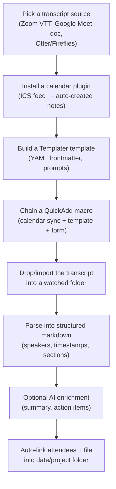

The goal is to remove manual copy-paste, from the calendar invite to the note and from the raw transcript to structured markdown.

## Capture flow

## Steps

1. **Choose your transcript source.** Zoom exports timestamped VTT files from Cloud Recordings. Google Meet has no direct plain-text export from the Meet UI, so export to a Google Doc first. Otter.ai, Fireflies, and Granola join meetings and export markdown directly.
2. **Install a calendar plugin** (e.g. Meeting Plus). Copy your calendar's ICS feed URL (Outlook, Google, or iCloud). It must be an ICS feed, not API access. Paste it into the plugin settings and pick the folder for auto-created notes.
3. **Build a Templater template** with YAML frontmatter (date, attendees, project, tags). Use `tp.date.now()`, `tp.system.prompt()`, and `tp.file.cursor()` to script the metadata and structure.
4. **Chain a QuickAdd macro.** It runs calendar sync, then applies the template, then optionally opens a Modal Form for attendees, project, and duration.
5. **Get the transcript into the vault.** Drop a VTT or text file into a folder that MeetingMind watches. Or enable an API integration (e.g. Fireflies) for automatic sync.
6. **Parse the transcript into markdown.** Use `vtt-to-markdown` for Zoom VTT files. Or let MeetingMind's parser split speakers and timestamps into sections.
7. **Optionally add AI enrichment.** MeetingMind Pro, or your own script against the Local REST API plus Claude or OpenAI, can write a summary and list action items and decisions.
8. **Link attendees and file the note.** Turn attendee names into `[[Person]]` wikilinks. Use Auto Note Mover to file the note by date or project.

## Tips

- The ICS feed needs no auth setup. It fills in attendees, time, and location with one click.
- For Zoom, always pull the VTT from Cloud Recordings (ready in 5-10 min). Plain transcripts lose the timestamps that VTT keeps.
- For Google Meet, export to a Google Doc, then download it as plain text. This keeps paragraphs better than copying from the Meet UI.
- With a folder watcher (MeetingMind), drop the file and do nothing else.
- Modal Forms with Templater collect project, name, participants, and duration in one dialog.
- Put attendee names in double brackets (`[[Person Name]]`) in the template. This builds the People graph.
- For a scripted pipeline, parse VTT with Python's `webvtt` module (or `vtt-to-markdown`). Then write the result into the vault through the Obsidian Local REST API.

## Common pitfalls

- **Exporting a transcript straight from the Google Meet UI**: this does not work. Create the Google Doc recap first.
- **Parsing VTT by hand**: the timestamps are verbose and repeat. Use an automated parser, or you lose speaker attribution.
- **Otter.ai has no push integration**: unlike Fireflies, each transcript needs a manual export or copy-paste, unless you go through MeetingMind.
- **Enabling folder templates after notes exist**: Templater's folder automation does not apply to existing files.
- **Modal Forms without Templater**: QuickAdd modal forms alone cannot generate dynamic frontmatter. Use both together.
- **Malformed transcript filenames**: the MeetingMind folder watcher accepts VTT, TXT, and DOCX only. It skips other files with no error.
- **Local REST API over plain HTTP**: it requires HTTPS and a bearer token by default. Requests fail unless you enable insecure mode.
- **AI enrichment failing silently**: if the Claude or OpenAI API key runs out of credit, MeetingMind Pro skips enrichment with no warning.

## Related

## Sources

- [MeetingMind Obsidian Plugin - GitHub](https://github.com/pattynextdoor/meetingmind)
- [Meeting Plus Obsidian Plugin - Community Plugins](https://community.obsidian.md/plugins/meetings-plus)
- [Streamlining Meeting Notes: Modal Forms, Templater, and QuickAdd - Medium](https://medium.com/@horaciochacn/streamlining-meeting-notes-in-obsidian-a-guide-to-modal-forms-templater-and-quickadd-83b318692ce4)
- [Obsidian Local REST API - GitHub](https://github.com/coddingtonbear/obsidian-local-rest-api)
- [Obsidian Templater Plugin Guide - Obsibrain](https://www.obsibrain.com/blog/obsidian-templater-plugin-guide)
- [vtt-to-markdown Converter - GitHub](https://github.com/suda/vtt-to-markdown)
- [Best Obsidian Plugins 2026 - Sébastien Dubois](https://www.dsebastien.net/the-must-have-obsidian-plugins-for-2026/)
- [How to Transcribe Zoom Meetings 2026 - TicNote](https://ticnote.com/en/blog/how-to-transcribe-zoom-meetings)
- [Google Meet Transcription Guide - Brass Transcripts](https://brasstranscripts.com/blog/google-meet-transcription-complete-guide-2025)
