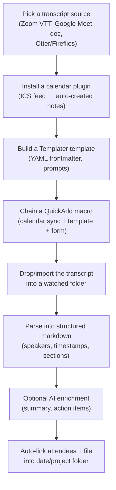

The friction to remove is manual copy-paste: from calendar invite to note, and from raw transcript to structured markdown.

## Capture flow

## Steps

1. **Choose your transcript source.** Native platforms: Zoom exports timestamped VTT files from Cloud Recordings; Google Meet exports to a Google Doc first (there's no direct plain-text export from the Meet UI). Third-party: Otter.ai, Fireflies, Granola auto-join and export markdown directly.
2. **Install a calendar plugin** (e.g. Meeting Plus): grab your calendar's ICS feed URL (Outlook/Google/iCloud, must be an ICS feed, not just API access), paste it into plugin settings, pick the target folder for auto-created notes.
3. **Build a Templater template** with YAML frontmatter (date, attendees, project, tags) using `tp.date.now()`, `tp.system.prompt()`, `tp.file.cursor()` to script the metadata and structure automatically.
4. **Chain a QuickAdd macro** that runs calendar sync → applies the template → optionally opens a Modal Form to collect attendees/project/duration in one dialog.
5. **Get the transcript into the vault.** Drop a VTT/text file into a watched folder for a plugin like MeetingMind, or enable an API integration (e.g. Fireflies) for automatic sync.
6. **Parse the transcript into markdown.** Use a tool like `vtt-to-markdown` for Zoom VTT files, or let MeetingMind's built-in parser split speakers/timestamps into readable sections.
7. **Optionally enrich with AI.** MeetingMind Pro, or your own script against the Local REST API plus Claude/OpenAI, can generate a summary and pull out action items and decisions.
8. **Auto-link and file the note.** Turn attendee names into `[[Person]]` wikilinks automatically, and use something like Auto Note Mover to file the finished note by date or project.

## Tips

- ICS feed integration needs no auth setup and pre-fills attendees/time/location with one click.
- For Zoom: always pull the VTT from Cloud Recordings (ready in 5-10 min), it preserves timestamps that plain transcripts lose.
- For Google Meet: export to a Google Doc first, then download as plain text, that preserves paragraph structure better than copying straight out of the Meet UI.
- A folder watcher (MeetingMind) beats manual imports, drop the file, walk away.
- Modal Forms (paired with Templater) collects project/name/participants/duration in one dialog instead of several prompts.
- Double-bracket attendee names in the template (`[[Person Name]]`) to build the People graph for free.
- For a scripted pipeline: parse VTT with Python's `webvtt` module (or `vtt-to-markdown`) and write directly into the vault via the Obsidian Local REST API.

## Common pitfalls

- **Trying to export a transcript straight from the Google Meet UI**: it doesn't work; you have to create the Google Doc recap first.
- **Manually parsing VTT**: timestamps are verbose with redundant entries; use an automated parser or you'll lose speaker attribution.
- **Otter.ai has no push integration**: unlike Fireflies, it needs manual export/copy-paste per transcript unless you go through MeetingMind.
- **Enabling folder templates after notes already exist**: Templater's folder automation doesn't retroactively apply to existing files.
- **Modal Forms without Templater installed**: QuickAdd's modal forms alone can't generate dynamic frontmatter; the two need to be paired.
- **Malformed transcript filenames**: MeetingMind's folder watcher expects specific formats (VTT/TXT/DOCX) and silently skips anything else, with no error.
- **Local REST API over plain HTTP**: it requires HTTPS + bearer token by default; requests get rejected unless you explicitly enable insecure mode.
- **AI enrichment failing silently**: if the Claude/OpenAI API key runs out of credit, MeetingMind Pro just skips the enrichment step without warning.

## Related

- session-handoff skill
- Meetings bundle
- Mentorship Hub chat

## Sources

- [MeetingMind Obsidian Plugin - GitHub](https://github.com/pattynextdoor/meetingmind)
- [Meeting Plus Obsidian Plugin - Community Plugins](https://community.obsidian.md/plugins/meetings-plus)
- [Streamlining Meeting Notes: Modal Forms, Templater, and QuickAdd - Medium](https://medium.com/@horaciochacn/streamlining-meeting-notes-in-obsidian-a-guide-to-modal-forms-templater-and-quickadd-83b318692ce4)
- [Obsidian Local REST API - GitHub](https://github.com/coddingtonbear/obsidian-local-rest-api)
- [Obsidian Templater Plugin Guide - Obsibrain](https://www.obsibrain.com/blog/obsidian-templater-plugin-guide)
- [vtt-to-markdown Converter - GitHub](https://github.com/suda/vtt-to-markdown)
- [Best Obsidian Plugins 2026 - Sébastien Dubois](https://www.dsebastien.net/the-must-have-obsidian-plugins-for-2026/)
- [How to Transcribe Zoom Meetings 2026 - TicNote](https://ticnote.com/en/blog/how-to-transcribe-zoom-meetings)
- [Google Meet Transcription Guide - Brass Transcripts](https://brasstranscripts.com/blog/google-meet-transcription-complete-guide-2025)
