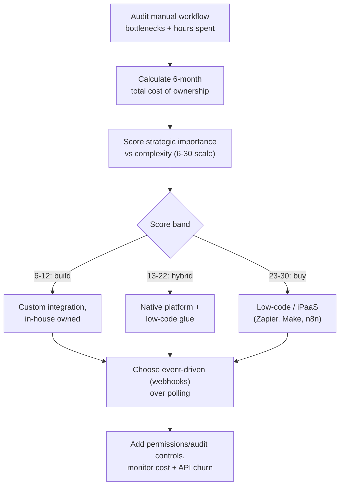

Most integration decisions in 2026 aren't binary "build or buy". They're a scoring exercise, and event-driven (webhook) design has displaced polling as the default.

## Decision flow

## Steps

1. **Audit manual workflow bottlenecks.** Status updates, ticket creation from chat messages, sync between your ticketing tool, wiki or docs tool and Slack, approval loops. Note frequency and person-hours.
2. **Calculate true cost of ownership over six months.** A moderately complex integration (e.g. Salesforce) runs roughly $24k-$32k to build, but ongoing maintenance (~$3k/month) is typically over 70% of lifetime cost. Weigh that against a platform subscription.
3. **Score strategic importance vs. complexity** across criteria like: is this core IP or a utility, how many tools does it touch, speed-to-market pressure, auth/security burden. Roughly: 6-12 → build, 13-22 → hybrid, 23-30 → buy.
4. **Pick the integration pattern.** Prefer event-driven webhooks (fire only when something happens) over scheduled polling; use scheduled cron jobs for genuine batch work, or a heartbeat-plus-webhook hybrid.
5. **Pick the platform tier.** Native automation first (the tracker's built-in automation, Slack workflows), free and covers a surprising number of cases. Zapier for wide, simple multi-app automation. Make for complex visual logic. n8n when you need self-hosting, cost control, or compliance features.
6. **Design permissions and audit controls up front.** Scope notifications to relevant channels, use role-based access, and audit integration changes monthly: most failures trace back to auth/permission misconfiguration, not the automation logic itself.
7. **Implement incrementally, native-first.** Start with a ticketing-tool automation rule posting to Slack before reaching for an external platform.
8. **Monitor cost and API churn monthly.** API deprecation and auth changes are the biggest hidden cost, not bugs in your logic.

## Tips

- Native platform automation (the tracker's built-in automation, Slack workflows, wiki or docs tool integrations) solves a surprising share of "we need an integration" requests at zero extra infrastructure cost.
- Webhooks > polling: polling hammers the API even when nothing changed; webhooks fire only on real events and typically include retry logic.
- Dedicate your best engineers to the 2-3 integrations that are genuinely a competitive advantage; buy or low-code the long tail.
- Pricing model matters: Zapier/Make charge per *operation* (expensive for 10+ step workflows); n8n charges per *execution* (whole workflow = one unit), often 80-90% cheaper for complex flows.
- Use template variables in your tracker's automation messages (`{{ticket.id}}`, `{{ticket.summary}}`) instead of custom code to carry context into Slack.
- For regulated environments, n8n's self-hosting, external secrets vaults, and RBAC matter in ways Zapier/Make don't offer.

## Common pitfalls

- **Underestimating total cost of ownership**: initial build is only ~30% of lifetime cost; ongoing API-churn maintenance is the real tax.
- **Building custom integrations for non-strategic work**: every upstream API change becomes an unplanned engineering task.
- **Polling instead of event-driven triggers**: wastes API calls and misses the retry semantics webhooks give you for free.
- **Neglecting permissions/data scope**: most breakage in integrations between your ticketing tool, Slack and wiki or docs tool is auth/permission misconfiguration, not logic bugs.
- **Choosing Zapier for a 10+ step workflow**: the per-operation pricing gets expensive fast; Make or n8n fit better.
- **Skipping native platform features**: teams sometimes reach for Zapier/n8n when the tracker's built-in automation or native Slack workflows already cover the case.
- **Assuming APIs stay stable**: budget ongoing time for deprecations, auth changes, and rate-limit adjustments as a standing cost, not a one-off.

## Related

- [Automation and Dev Tooling](/notes/automation-and-dev-tooling/)
- Finding Undocumented API Endpoints
- Mentorship Hub chat

## Sources

- [Build vs. buy AI agent integrations: a 2026 decision framework](https://composio.dev/content/build-vs-buy-ai-agent-integrations)
- [Make vs Zapier, and why n8n is the best alternative](https://blog.n8n.io/make-vs-zapier/)
- [N8N + Webhooks: Build Event-Driven Automations That Replace Your Cron Jobs](https://blog.elest.io/n8n-webhooks-build-event-driven-automations-that-replace-your-cron-jobs/)
- [Using Webhook Integrations for Event-Driven Automation](https://www.stonebranch.com/blog/webhook-integrations-for-event-driven-automation)
