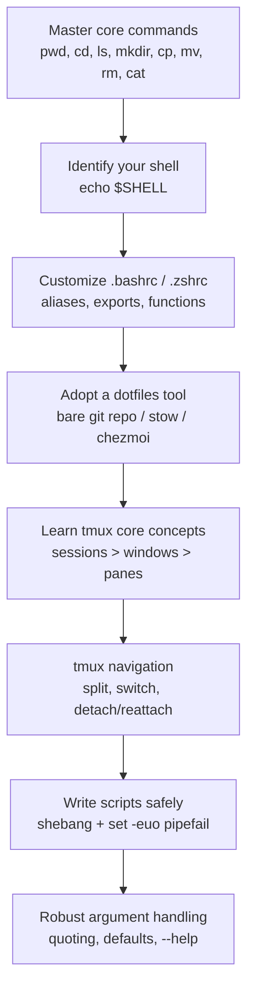

The progression from "comfortable on Windows" to "comfortable on the command line": core commands, shell config, versioned dotfiles, tmux, then turning repetitive manual steps into scripts you can trust.

## Learning path



## Steps

1. **Master the eight commands that cover most days:** `pwd`, `cd`, `ls`, `mkdir`, `touch`, `cp`, `mv`, `rm`, `cat`. If you're on Windows, WSL or Git Bash is enough to start practicing immediately.
2. **Identify your shell:** `echo $SHELL` tells you whether you're editing `~/.bashrc` (Bash) or `~/.zshrc` (Zsh), editing the wrong file is a classic time-sink.
3. **Customize your shell config:** add aliases (`alias gs='git status'`), export variables (`PATH`, `EDITOR`), define functions. Reload with `source ~/.bashrc` to test without restarting the terminal.
4. **Pick one dotfiles tool and commit to it early**, before your config accumulates cruft:
   - **Bare git repo**: minimal, no extra tooling.
   - **GNU Stow**: symlink-based, no dependencies: `stow -d ~/dotfiles -t ~ <package>`.
   - **chezmoi**: supports templating (`{{ .hostname }}`) for one repo across Windows/macOS/Linux.
5. **Learn tmux's hierarchy:** sessions contain windows contain panes. Start one with `tmux new -s work`; the prefix key is `Ctrl+b` by default.
6. **Navigate tmux:** split panes with `Prefix "` (horizontal) or `Prefix %` (vertical), switch windows with `Prefix 1-9`, detach with `Prefix d` and reattach later with `tmux attach -t work`. Many people remap the prefix to `Ctrl+a` in `~/.tmux.conf`.
7. **Write scripts defensively.** Start every script with:
   ```bash
   #!/usr/bin/env bash
   set -o errexit
   set -o nounset
   set -o pipefail
   ```
   Run them through `shellcheck` before trusting them.
8. **Handle arguments and undefined variables carefully.** Quote everything (`"${VAR-}"`), support `-h`/`--help`, and gate a trace mode behind an env var (`[[ -n "${TRACE-}" ]] && set -o xtrace`) for debugging.

## Tips

- Always use `#!/usr/bin/env bash` over `#!/bin/bash`, more portable across systems where bash isn't at that exact path.
- Test a new script by running `bash script.sh` before `chmod +x`, catches syntax errors without committing to "this is executable now."
- `tmux ls` / `tmux kill-session -t <name>` to manage background sessions, detached sessions survive SSH disconnects, which is the whole point for remote work.
- chezmoi's templating means one dotfiles repo can safely target Windows, macOS, and Linux without leaking machine-specific paths.

## Common pitfalls

- **Editing the wrong rc file** (`.bashrc` when you're actually running zsh), aliases and functions mysteriously "don't work." Check `$SHELL` first.
- **Forgetting `set -o pipefail`**: a script can silently "succeed" even when a command in the middle of a pipeline failed.
- **Committing secrets in dotfiles**: API keys, SSH keys in a public repo is a hard-to-undo breach; use chezmoi's encryption or yadm's encrypt feature for anything sensitive.
- **Stow failing on pre-existing files**: it won't overwrite conflicting dotfiles already in `~`; back them up or remove them first.
- **`rm -rf` without checking the path first**: always `ls <path>` before deleting; there's no undo.
- **Referencing `${VAR}` under `set -u` without a default**: use `${VAR-default}` so undefined variables don't kill the script outright.
- **Scripts that grow without functions/`local` variables**: becomes unmaintainable fast; break logic into functions with locally scoped variables.

## Related

- [WSL2 Setup on Windows](/notes/wsl2-setup-on-windows/)
- [Linux vs Windows for AI, Scripts, and Automation](/notes/linux-vs-windows-for-ai-scripts-and-automation/)
- [Automation and Dev Tooling](/notes/automation-and-dev-tooling/)
- Mentorship Hub chat

## Sources

- [Shell Script Best Practices - Sharat's](https://sharats.me/posts/shell-script-best-practices/)
- [Tmux Tutorial: The Complete Developer Workflow Guide (2026) - DEV Community](https://dev.to/_d7eb1c1703182e3ce1782/tmux-tutorial-the-complete-developer-workflow-guide-2026-33b3)
- [Why use chezmoi? - chezmoi](https://www.chezmoi.io/why-use-chezmoi/)
- [Linux Command Line Tutorial - freeCodeCamp](https://www.freecodecamp.org/news/linux-command-line-tutorial/)
- [Understanding bashrc and zshrc - Medium](https://medium.com/@dev.ayushpaudel/understanding-bashrc-and-zshrc-a-developers-guide-to-shell-configuration-3aeeca40a566)
- [Dotfile management using GNU stow - Tushar Chauhan](https://www.tusharchauhan.com/writing/dotfile-management-using-gnu-stow/)
- [Exploring Tools For Managing Your Dotfiles - GBergatto](https://gbergatto.github.io/posts/tools-managing-dotfiles/)
- [How to Use set -e -o pipefail in Bash, and Why](https://www.namehero.com/blog/how-to-use-set-e-o-pipefail-in-bash-and-why/)
