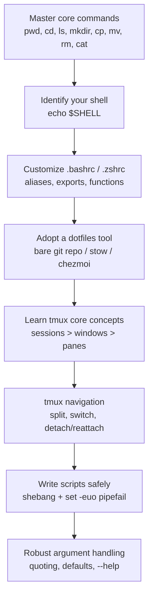

This path goes from "comfortable on Windows" to "comfortable on the command line." It covers core commands, shell config, versioned dotfiles, tmux, and turning repeated manual steps into scripts you can trust.

## Learning path



## Steps

1. **Learn the eight commands you use most days:** `pwd`, `cd`, `ls`, `mkdir`, `touch`, `cp`, `mv`, `rm`, `cat`. On Windows, WSL or Git Bash is enough to start practicing.
2. **Identify your shell:** `echo $SHELL` shows whether you use Bash (`~/.bashrc`) or Zsh (`~/.zshrc`). Editing the wrong file wastes a lot of time.
3. **Customize your shell config:** add aliases (`alias gs='git status'`), export variables (`PATH`, `EDITOR`), define functions. Reload with `source ~/.bashrc` to test changes without restarting the terminal.
4. **Pick one dotfiles tool early**, before your config builds up clutter:
   - **Bare git repo**: minimal, no extra tooling.
   - **GNU Stow**: symlink-based, no dependencies: `stow -d ~/dotfiles -t ~ <package>`.
   - **chezmoi**: supports templating (`{{ .hostname }}`) for one repo across Windows/macOS/Linux.
5. **Learn tmux's hierarchy.** A session holds windows, and each window holds panes. Start a session with `tmux new -s work`. The default prefix key is `Ctrl+b`.
6. **Navigate tmux:** split panes with `Prefix "` (horizontal) or `Prefix %` (vertical). Switch windows with `Prefix 1-9`. Detach with `Prefix d`, then reattach later with `tmux attach -t work`. Many people change the prefix to `Ctrl+a` in `~/.tmux.conf`.
7. **Write scripts with safe defaults.** Start every script with this header:
   ```bash
   #!/usr/bin/env bash
   set -o errexit
   set -o nounset
   set -o pipefail
   ```
   Run each script through `shellcheck` before you rely on it.
8. **Handle arguments and unset variables with care.** Quote everything (`"${VAR-}"`), support `-h` and `--help`, and turn on trace mode only when you need to debug (`[[ -n "${TRACE-}" ]] && set -o xtrace`).

## Tips

- Use `#!/usr/bin/env bash` instead of `#!/bin/bash`. It works on more systems, where bash may not be at that exact path.
- Run `bash script.sh` before `chmod +x`. This catches syntax errors without marking the file executable.
- Use `tmux ls` and `tmux kill-session -t <name>` to manage background sessions. Detached sessions survive SSH disconnects, which matters most for remote work.
- chezmoi templates let one dotfiles repo cover Windows, macOS, and Linux without exposing machine-specific paths.

## Common pitfalls

- **Editing the wrong rc file** (`.bashrc` when you run zsh). Aliases and functions seem broken. Check `$SHELL` first.
- **Forgetting `set -o pipefail`**: a script can report success when a command in the middle of a pipeline fails.
- **Committing secrets in dotfiles**: API keys or SSH keys in a public repo cause a breach that is hard to undo. Use chezmoi's encryption or yadm's encrypt feature for anything sensitive.
- **Stow failing on pre-existing files**: it does not overwrite conflicting dotfiles already in `~`. Back them up or remove them first.
- **`rm -rf` without checking the path first**: run `ls <path>` before deleting. Deletes cannot be undone.
- **Referencing `${VAR}` under `set -u` without a default**: use `${VAR-default}` so an unset variable does not stop the script.
- **Scripts that grow without functions or `local` variables**: they become hard to maintain. Split the logic into functions and use local variables.

## Related

- [WSL2 Setup on Windows](/notes/wsl2-setup-on-windows/)
- [Linux vs Windows for AI, Scripts, and Automation](/notes/linux-vs-windows-for-ai-scripts-and-automation/)
- [Automation and Dev Tooling](/notes/automation-and-dev-tooling/)

## Sources

- [Shell Script Best Practices - Sharat's](https://sharats.me/posts/shell-script-best-practices/)
- [Tmux Tutorial: The Complete Developer Workflow Guide (2026) - DEV Community](https://dev.to/_d7eb1c1703182e3ce1782/tmux-tutorial-the-complete-developer-workflow-guide-2026-33b3)
- [Why use chezmoi? - chezmoi](https://www.chezmoi.io/why-use-chezmoi/)
- [Linux Command Line Tutorial - freeCodeCamp](https://www.freecodecamp.org/news/linux-command-line-tutorial/)
- [Understanding bashrc and zshrc - Medium](https://medium.com/@dev.ayushpaudel/understanding-bashrc-and-zshrc-a-developers-guide-to-shell-configuration-3aeeca40a566)
- [Dotfile management using GNU stow - Tushar Chauhan](https://www.tusharchauhan.com/writing/dotfile-management-using-gnu-stow/)
- [Exploring Tools For Managing Your Dotfiles - GBergatto](https://gbergatto.github.io/posts/tools-managing-dotfiles/)
- [How to Use set -e -o pipefail in Bash, and Why](https://www.namehero.com/blog/how-to-use-set-e-o-pipefail-in-bash-and-why/)
