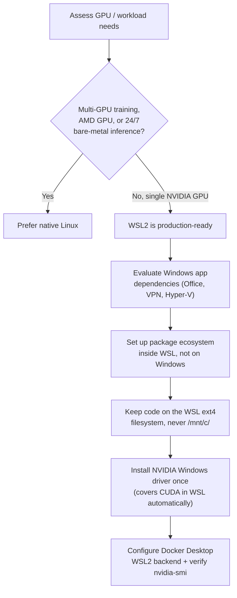

Linux and Windows (via WSL2) have converged a lot for AI/ML and scripting work. The right call in 2026 depends on the workload, not on a general "Linux is better" claim.

## Decision flow

## Steps

1. **Assess GPU and workload requirements.** Multi-GPU training, AMD GPUs, or 24/7 bare-metal inference favor native Linux. A single NVIDIA GPU on a Windows machine works fine under WSL2 (or the WSL3 preview, if you need near-native GPU numbers).
2. **Check Windows application dependencies.** If you're locked into Windows-only tools (Office, Hyper-V, a corporate VPN client), start with WSL2 on Windows rather than committing to bare Linux.
3. **Choose your WSL tier.** WSL2 stable is the right default for development and containers. WSL3 (preview as of August 2026) gets CUDA/PyTorch within ~3-5% of bare metal, but isn't recommended for production yet.
4. **Set up the package ecosystem in the right place.** `apt`/`conda`/`pip` inside WSL (or native Linux), not on Windows itself. On native Windows, winget/Scoop cover CLI tools only.
5. **Keep the project filesystem inside WSL's ext4**, not under `/mnt/c/Users/...`. Crossing that boundary costs 7-60x on I/O and metadata operations.
6. **Install GPU drivers once, correctly.** On WSL2: install the NVIDIA *Windows* driver, it exposes CUDA into WSL automatically. On native Linux: install the driver per distro/GPU. Verify either way with `nvidia-smi`.
7. **Set up containers and confirm GPU passthrough.** Docker Desktop with the WSL2 backend needs Windows 10 build 19045+ or Windows 11 23H2+ and WSL 2.1.5+. Confirm `nvidia-smi` and CUDA libraries are visible *inside* the container, not just on the host.
8. **Pick your scripting shell deliberately.** Bash on WSL2/Linux for portable automation; PowerShell 7+ only when you're specifically automating Windows infrastructure.

## Tips

- Clone all repos into the WSL filesystem, this is the single most common WSL2 performance mistake to avoid.
- Use VS Code Remote-SSH into WSL2: edit on Windows, run/compile on Linux, no path-translation overhead.
- Create conda environments *inside* WSL only, a Windows-created environment and a WSL-created one are separate ecosystems despite sharing NTFS.
- Winget ships with Windows 11 now, so there's rarely a reason to also install Chocolatey or Scoop just for basic CLI tools.
- NixOS is worth it if you control the infrastructure and want declarative, reproducible builds; otherwise plain apt/dnf is simpler to reason about.

## Common pitfalls

- **Windows paths baked into `.bashrc`/`.gitconfig`** (e.g. `USERPROFILE=/mnt/c/Users/...`) quietly locks even pure-Linux operations into Windows filesystem performance.
- **`inotify`-based file watching from `/mnt/c`** (nodemon, `pytest --watch`, webpack, `cargo watch`) is unreliable, keep watched files on the WSL filesystem.
- **GPU driver version mismatch**: WSL2's CUDA support rides on the *Windows* NVIDIA driver, not a Linux one; mismatched versions break GPU access entirely.
- **Assuming WSL3 is generally available**: as of August 2026 it's preview-only; WSL2 is still the stable choice for production.
- **Docker Desktop WSL2 integration failing silently** on WSL < 2.1.5, with a cryptic "distro not registered" error, run `wsl --update` first.
- **Switching between WSL2 and native Linux mid-project** creates git config confusion (`/mnt/c` paths vs `/home` paths), commit to one platform per project.

## Related

- [WSL2 Setup on Windows](/notes/wsl2-setup-on-windows/)
- [PowerToys and winget](/notes/powertoys-and-winget/)
- [Linux Terminal and Shell Scripting](/notes/linux-terminal-and-shell-scripting/)

## Sources

- [WSL 3: GPU and NPU Passthrough for Windows AI Dev (Build 2026)](https://byteiota.com/wsl3-gpu-npu-passthrough-windows-ai-dev/)
- [CUDA on Windows Subsystem for Linux (WSL) - NVIDIA Developer](https://developer.nvidia.com/cuda/wsl)
- [Docker Desktop on Windows Installation and Setup](https://docs.docker.com/desktop/setup/install/windows-install/)
- [Managing Native Linux vs WSL 1 & 2: Technical Comparison for Windows Admins](https://msendpointmgr.com/2025/12/15/managing-native-linux-vs-wsl-1-2-a-technical-comparison-for-windows-admins/)
- [WSL2 Filesystem Speed Optimization](https://brainwagon.org/blog/2026_07_11_wsl2_filesystem_speed)
- [The Linux-Windows Bridge: Practical WSL2 Usage - Medium](https://medium.com/@saehwanpark/the-linux-windows-bridge-i-wish-id-discovered-years-ago-22a3bff3859f)
- [NixOS: Declarative Linux Distribution](https://nixos.org/)
- [Is NixOS the Most Powerful Linux Distro in 2026?](https://allthingsopen.org/articles/nixos-most-powerful-linux-distro-2026)
