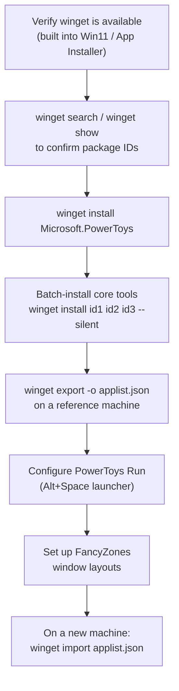

winget (Windows Package Manager) and Microsoft PowerToys turn Windows setup from a click-through chore into scripted, reproducible infrastructure. This is the direct answer to "how do I use Windows like a pro."

## Setup flow



## Steps

1. **Verify winget.** It ships with Windows 11 and modern Windows 10 (build 1809+) via App Installer. If missing, get it from the Microsoft Store or run `Repair-WinGetPackageManager` in PowerShell.
2. **Search before you script.** `winget search <name>` to confirm a package exists, `winget show <id>` to check the installer type/version.
3. **Install PowerToys.**
   ```
   winget install Microsoft.PowerToys
   ```
   It auto-updates via the Microsoft Store.
4. **Batch-install your core toolset** non-interactively:
   ```
   winget install --id <id> --exact --silent --accept-package-agreements --accept-source-agreements
   ```
5. **Export a reference machine's setup:**
   ```
   winget export -o applist.json
   ```
   The JSON is human-readable and safe to commit to a dotfiles repo.
6. **Configure PowerToys Run** (default `Alt+Space`): enable the plugins you actually use (Shell, Calculator, Windows Settings) and disable the rest to keep search latency low.
7. **Set up FancyZones** (`Win+Shift+\``): build a Grid/Canvas layout per monitor, optionally bind hotkeys (`Win+Ctrl+Alt+<number>`) to jump between layouts.
8. **On a new machine, import:**
   ```
   winget import applist.json --ignore-versions --accept-package-agreements
   ```
9. **Turn on Command Not Found** in PowerToys settings, when a PowerShell 7 command isn't found, it suggests the winget package that provides it.

## Tips

- Use `--include-versions` when exporting a *pinned* reference build; use `--ignore-versions` on import so you pick up newer stable releases instead of fighting version drift.
- Store `applist.json` in your dotfiles repo alongside a short note on what each tool is for.
- Enable FancyZones' "Override Windows Snap" if you run many windows, it remaps `Win+Arrow` to zone navigation.
- PowerToys' Environment Variables editor supports named *profiles* (e.g. a `Java_Dev` profile) you toggle on/off instead of hand-editing `PATH`.
- Text Extractor needs the OCR language pack installed, check with `Get-WindowsCapability -Online | Where-Object {$_.Name -Like 'Language.OCR*'}`.

## Common pitfalls

- **`winget export` only captures winget-catalog packages**: Microsoft Store apps and unlisted third-party tools are silently skipped; list those separately.
- **Running from a non-admin prompt**: installs needing elevation fail silently; test elevated first.
- **`--ignore-versions` on import** can pull in a breaking newer release; pin with `--include-versions` for anything critical.
- **FancyZones won't snap elevated windows** (e.g. an admin Terminal) unless PowerToys itself runs as administrator.
- **Environment Variables profiles are User-scope only**: System variables need admin mode, which trips people up switching contexts.
- **Large `applist.json` (100+ apps)** slows down import, split into `essentials.json` / `dev-tools.json` and import in stages.
- `winget import` continues past failures by default, check the log at `%LOCALAPPDATA%\Packages\Microsoft.DesktopAppInstaller_8wekyb3d8bbwe\LocalState\DiagOutputDir` to confirm everything actually installed.

## Related

- [WSL2 Setup on Windows](/notes/wsl2-setup-on-windows/)
- [Linux vs Windows for AI, Scripts, and Automation](/notes/linux-vs-windows-for-ai-scripts-and-automation/)
- Mentorship Hub chat

## Sources

- [Windows Package Manager (winget) Overview](https://learn.microsoft.com/en-us/windows/package-manager/winget/)
- [winget export command documentation](https://learn.microsoft.com/en-us/windows/package-manager/winget/export)
- [winget install command documentation](https://learn.microsoft.com/en-us/windows/package-manager/winget/install)
- [Microsoft PowerToys - Overview and utilities](https://learn.microsoft.com/en-us/windows/powertoys/)
- [PowerToys Run quick launcher](https://learn.microsoft.com/en-us/windows/powertoys/run)
- [FancyZones window manager](https://learn.microsoft.com/en-us/windows/powertoys/fancyzones)
- [PowerRename bulk file renaming](https://learn.microsoft.com/en-us/windows/powertoys/powerrename)
- [Text Extractor OCR utility](https://learn.microsoft.com/en-us/windows/powertoys/text-extractor)
- [Command Not Found PowerShell module](https://learn.microsoft.com/en-us/windows/powertoys/cmd-not-found)
- [Environment Variables editor](https://learn.microsoft.com/en-us/windows/powertoys/environment-variables)
