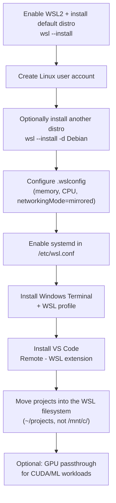

WSL2 (Windows Subsystem for Linux 2) runs a real Linux kernel inside a lightweight Hyper-V VM, giving you a native Linux dev environment without leaving Windows. Setup is a single command; getting it *fast* takes a bit of tuning.

## Setup flow



## Steps

1. **Enable WSL2 and install a distro.** Run `wsl --install` in an administrator PowerShell. This turns on the WSL and Virtual Machine Platform features, sets WSL 2 as default, and installs Ubuntu. Restart when prompted.
2. **Create your Linux user.** On first launch, set a username/password; this account gets `sudo` automatically and is specific to that distro.
3. **Pick a different distro if you want one.** `wsl --list --online` to see options, `wsl --install -d Debian` to add one, `wsl --set-default <DistroName>` to switch the default.
4. **Configure `.wslconfig`** at `%USERPROFILE%\.wslconfig` to bound VM resources:
   ```ini
   [wsl2]
   memory=24GB
   processors=8
   networkingMode=mirrored
   dnsTunneling=true
   firewall=true
   localhostForwarding=true
   ```
   A good memory rule of thumb is host RAM minus 8GB. Apply changes with `wsl --shutdown` (closing the terminal window is not enough).
5. **Enable systemd** in `/etc/wsl.conf` inside the distro:
   ```ini
   [boot]
   systemd=true
   ```
   Docker, Tailscale, and snapd all depend on systemd being active.
6. **Install Windows Terminal** (Microsoft Store), it auto-creates a profile per WSL distro.
7. **Install VS Code's "Remote - WSL" extension** so `code .` from inside Linux opens a fully remote-aware editor window.
8. **Keep project files inside the WSL filesystem** (e.g. `~/projects`), not under `/mnt/c/...`. Access them from Windows Explorer via `\\wsl$\<DistroName>\home\<User>` if needed.
9. **GPU passthrough (optional, for AI workloads):** install only the CUDA *Toolkit* inside WSL (never the Linux GPU driver, that comes from Windows via GPU-PV). Verify with `nvidia-smi` inside the distro.

## Tips

- `networkingMode=mirrored` (Windows 11 22H2+) takes WSL2 networking from ~3 Mbps to near-native speeds, set it by default.
- Exclude the WSL VHDX, Docker data, and `~/projects` from Windows Defender real-time scanning; without this, I/O can be 10-50x slower.
- Use version managers inside WSL (`pyenv`, `fnm`) rather than installing Python/Node globally.
- Mount extra drives via `/etc/fstab` with Virtio-FS/9p rather than reaching across `/mnt/c/`.

## Common pitfalls

- **Working from `/mnt/c/`**: `node_modules`, `.git`, and build artifacts there make `git status`/`npm install`/builds 10-50x slower. Move the project into the Linux filesystem.
- **Installing the full `nvidia-cuda` meta-package** instead of `cuda-toolkit-13-x`, breaks the driver stubs. GPU drivers only come through Windows.
- **Forgetting `systemd=true`**: Docker/Tailscale/snapd silently fail to start.
- **Third-party firewalls/AV** (Kaspersky, AVG, Avast, Symantec) have been reported to block WSL networking outright.
- **`.wslconfig` changes not applying**: a plain terminal close doesn't restart the VM; run `wsl --shutdown` first.
- Running an older Windows 11 build (<22H2) with `networkingMode=mirrored` set causes network isolation failures, check with `winver`.

## Related

- [Linux vs Windows for AI, Scripts, and Automation](/notes/linux-vs-windows-for-ai-scripts-and-automation/)
- [Linux Terminal and Shell Scripting](/notes/linux-terminal-and-shell-scripting/)

## Sources

- [How to install Linux on Windows with WSL](https://learn.microsoft.com/en-us/windows/wsl/install)
- [Set up a WSL development environment](https://learn.microsoft.com/en-us/windows/wsl/setup/environment)
- [FAQ's about Windows Subsystem for Linux](https://learn.microsoft.com/en-us/windows/wsl/faq)
- [Configuring .wslconfig and wsl.conf in WSL: a complete guide](https://mundobytes.com/en/wslconfig-and-wslconf-configuration-in-wsl/)
- [WSL2 Complete Setup & Optimization Guide for Windows 11 Developers (2025/2026)](https://sharedtutor.com/2026/07/12/wsl2-complete-setup-amp-optimization-guide-for-windows-11-developers-2025-2026/)
- [Enabling GPU in WSL2 for ML and CUDA: A Complete Guide](https://mundobytes.com/en/How-to-enable-GPU-in-WSL2-for-ML-and-CUDA-step-by-step/)
